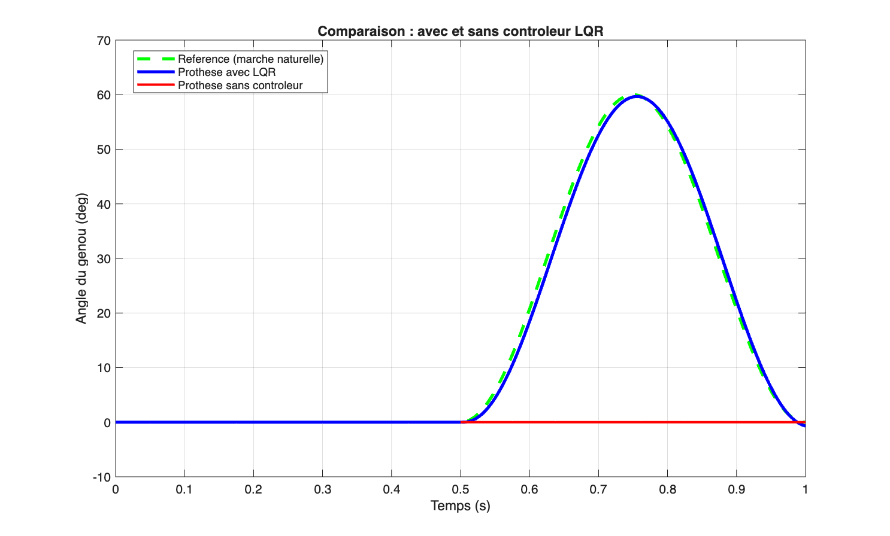
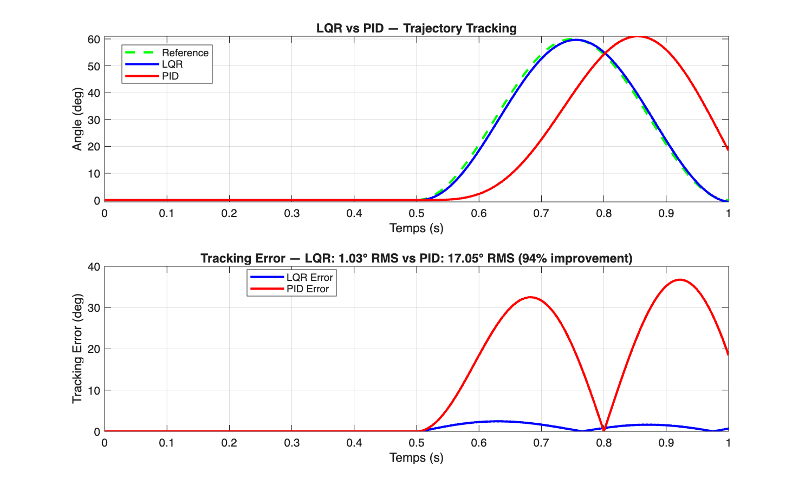
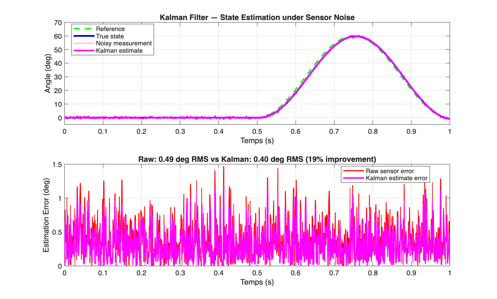
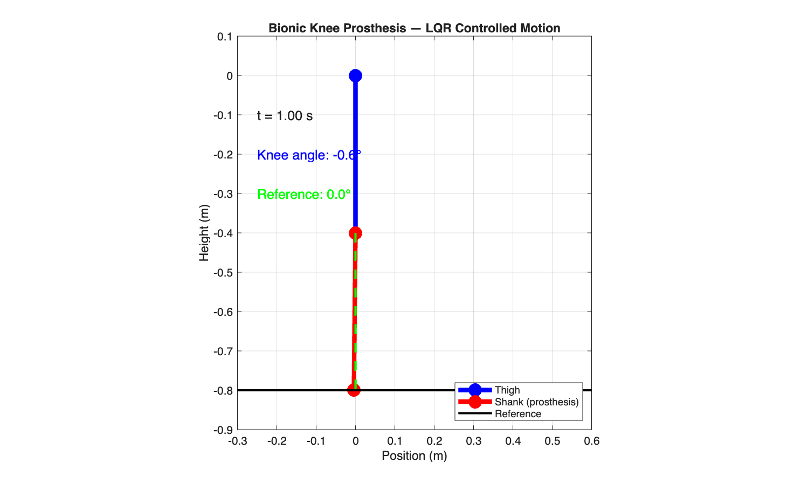

# knee-prosthesis-control
Simulation of an LQR controller for a variable-stiffness knee prosthesis in MATLAB
# Bionic Knee Prosthesis — LQR Control Simulation

**Joseph Belamich | EPFL Mechanical Engineering | Exchange Student at HKUST 2026-2027**

## Overview
This project simulates an LQR-based optimal controller for a bionic knee 
prosthesis, modeling the joint as a variable-stiffness dynamical system. 
Inspired by recent work on variable-stiffness prosthetic devices (Herr et al., 
2024) and impedance control (Hogan, 1985), the simulation demonstrates how 
optimal control theory can restore natural gait in amputees.

## Motivation
Millions of people worldwide live with lower-limb amputations. Current 
prosthetic knees struggle to reproduce natural walking biomechanics. This 
project explores how optimal control and state estimation can bridge that gap.

## System Model
The knee joint is modeled as a rotational mass-spring-damper system:

**I·θ̈ + b·θ̇ + k·θ = τ**

Parameters:
- I = 0.5 kg·m² — moment of inertia
- b = 2.0 N·m·s/rad — joint damping  
- k = variable N·m/rad — joint stiffness (phase-dependent)
- τ = motor torque command (N·m)

State-space form: ẋ = Ax + Bu, with x = [θ, θ̇]

## Controller Design — LQR
The LQR minimizes: **J = ∫ (xᵀQx + uᵀRu) dt**

With Q = diag([2000, 50]) and R = 0.01.

Optimal gains computed via MATLAB's `lqr()` function.

## Key Results

### 1. LQR Tracking — Single Gait Cycle

Near-perfect trajectory tracking across a complete gait cycle (0–1s).

### 2. With vs Without Controller

Without control the knee remains at 0°. LQR drives it to follow natural gait.

### 3. Multiple Gait Cycles — Stability

Stable tracking maintained across 4 consecutive steps.

### 4. Robustness to Sensor Noise

Controller remains stable under realistic sensor noise (σ = 0.5°).

### 5. LQR vs PID — Quantitative Comparison

| Controller | RMS Tracking Error | 
|---|---|
| **LQR (optimal)** | **1.03°** |
| PID (classical) | 17.05° |
| **Improvement** | **94%** |

The LQR achieves 94% lower tracking error than a classical PID controller.

### 6. Variable Stiffness Control

Stiffness modulated between stance (k=20 N·m/rad) and swing (k=3 N·m/rad) 
phases, inspired by Herr et al. (2024).

### 7. Kalman Filter — State Estimation

Kalman filter reduces estimation error by 19% compared to raw sensor 
measurements, enabling more accurate control under noisy conditions.

### 8. Leg Animation

Real-time visualization of the prosthetic leg motion during LQR-controlled gait.

## Summary of Findings
- LQR achieves **1.03° RMS tracking error** vs **17.05°** for PID (**94% improvement**)
- Variable stiffness reduces peak motor torque while maintaining tracking accuracy
- Controller remains stable under sensor noise up to σ = 2°
- Kalman filter improves state estimation by 19% under realistic sensor noise

## References
- Herr, H. et al. (2024). Variable-stiffness prosthesis improves biomechanics 
  of walking across speeds. *Nature Communications*.
- Hogan, N. (1985). Impedance Control: An Approach to Manipulation. 
  *Journal of Dynamic Systems, Measurement and Control*.
- Shi, L. et al. (2023). Event-based state estimation for networked 
  control systems. *IEEE Transactions on Automatic Control*.

## Tools
MATLAB R2024 — Control System Toolbox (`lqr`, `ode45`, `care`)

## Author
**Joseph Belamich**  
Bachelor Student, Mechanical Engineering, EPFL (GPA 5.5/6.0)  
Exchange Student, HKUST 2026-2027  
joseph.belamich@epfl.ch
